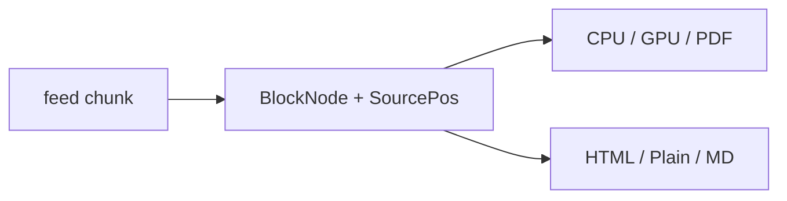

# Nisaba Markdown Engine — Complete Spec Parity

[RELEASE] Phase 1-4 CommonMark 0.30 + GFM Verified

Smart punctuation & HTML5 entities: “Nisaba” — it’s fast – really… © 2026 € ♥ 😀 and literal *escaped* punctuation.

## Delimiter Stack & Inline Edge Cases

- Intraword underscore preserved: foo_bar_baz and my_var_name
- Intraword asterisk emphasis: foo*bar*baz
- Nested emphasis: **bold *and italic* bold** plus ***bold italic*** and ~~strikethrough~~
- Multi-backtick code span: ``code with ` inner backtick`` and <kbd>Ctrl</kbd> + <kbd>S</kbd>
- Nested brackets & reference links: [Outer [Inner] **Link**](<https://nisaba.dev/markdown spec> "Multi-line
reference title"), [Collapsed](https://nisaba.dev/collapsed), [Shortcut](https://nisaba.dev/shortcut)
- Strict GFM autolinks: ([https://en.wikipedia.org/wiki/C_(programming_language)](https://en.wikipedia.org/wiki/C_(programming_language))), [www.nisaba.dev](http://www.nisaba.dev), [dev@nisaba.dev](mailto:dev@nisaba.dev)
- Custom extension hook: reviewed by @architect for issue #108

> [!NOTE]
> Lazy continuation & alerts:
> this second line lazily continues the alert paragraph seamlessly.

> Classic BlockQuote line 1
> lazy continuation line 2 inside the same paragraph.

### Loose List vs Tight List & Task Checkboxes

- [x] Streaming `feed()` + `snapshot()` + `finish()`

- [x] Exact `SourcePos` on every `BlockNode` and `InlineSpan`

- [x] GFM `Tagfilter` sanitization & multi-format exporters

### Indented Code Block & Syntax-Highlighted Fenced Code

```
// 4-space Indented Code Block (CommonMark 4.4)
auto parser = MarkdownParser(opts);
parser.feed(chunk);
```

```cpp
// Fenced C++20 Code Block
MarkdownParseOptions opts{.smart_punctuation = true, .validate_utf8 = true};
auto doc = MarkdownDocument::from_string(source, opts);
```

### Aligned GFM Table

| Capability | Alignment | Status |
| :--- | :---: | ---: |
| Streaming `feed()` | Centered | **Verified** |
| HTML5 Entities (2125) | — © | **Verified** |
| Exporters (`HTML`/`MD`/`TXT`) | Round-Trip | **Verified** |

### Display Math & Diagram Blocks

$$
E = \frac{1}{2}mv^2 + \sum_{i=1}^{n} \alpha_i
$$



&lt;script>alert('must-be-filtered')&lt;/script>
